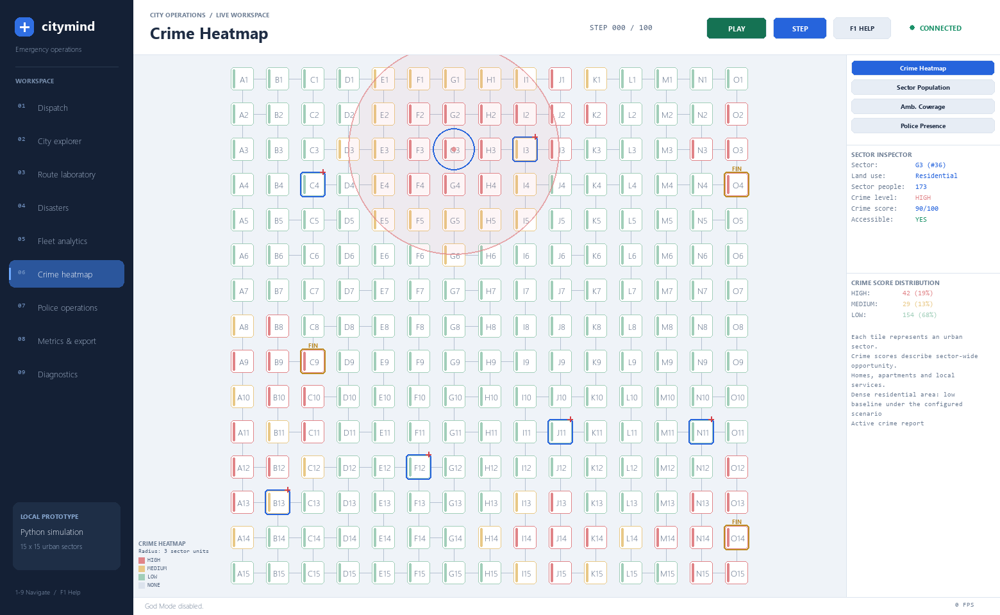

# Bank placement and crime heatmap

Medical-center placement is preserved. A regression captures the previous exact coordinates for ten seeds (including 42) and verifies that the new layout keeps every one unchanged.

## Placement

Banks are repositioned only after the medical genetic algorithm finishes. The final sites are seeded random choices among feasible empty/previous bank plots, with:

- At least four Manhattan grid blocks from every medical center.
- At least seven blocks between banks.
- Three different city quadrants.
- A separate police station plot two or three blocks away with normal road access.

Each bank gets a different cardinal police direction. For example, one can have its station east, another west, and another north or south. These are straight grid-axis offsets, not diagonal shorthand. Police stations stay at least two blocks from medical centers. The planner prefers two-block sites where practical. It does not place a station in the bank building.

This selection changes bank plots and supporting police locations; it does not move hospitals, ambulances, roads or residential plots. New-city generation rejects infeasible spacing instead of silently squeezing facilities together. The same seed reproduces a layout; different seeds can choose different layouts.

## Crime heatmap

Pygame's Crime Heatmap and React's Crime Heatmap toggle show the same Python scores. Clicking a node shows its score and explanation. Legacy `risk_level`, `risk_predictions` and `risk_index` remain compatibility fields for existing clients and routing; the live map now uses the configured crime scenario below.

| Condition | Default behavior |
| --- | --- |
| Bank plot | Score 90, HIGH |
| Within one/two grid blocks of a bank | Score 80/70, HIGH, except dense residential nodes |
| Open industrial/residential interface | Elevated score when industry and residences are within two blocks and local residential density is low |
| Dense residential node | LOW background score 15 unless within a reported crime area |
| Active report | Three-cell circular footprint: strongest at its center and weaker toward its boundary |
| Resolved report | Historical contribution fades gradually with a 20-step half-life |
| Other locations | LOW background score 15 |

A dense residential node has at least five residential plots in its surrounding 3×3 neighborhood, including itself. Under this requested scenario, that low-baseline rule takes precedence over nearby bank/industrial spillover for residential nodes. A bank plot itself remains a high-value asset. A report overrides the low-baseline rule within its circular radius, including neighboring dense residential nodes. The effect weakens with distance; it does not mark the entire city high.

HIGH starts at 60; MEDIUM at 35. The score is a 0–100 simulation index, **not a percentage probability or a measured crime rate**. These values and spacing limits live in `config/simulation_config.py`.

The map refreshes immediately when a report is submitted and as simulation time advances. Reports have a configurable Euclidean radius of three grid cells, rendered as a circular boundary in Pygame and React when Crime Heatmap is enabled. Only nodes inside the circle receive incident influence. Road closures do not clip a geographic crime footprint; dispatch still obeys the road restrictions. Existing reports, severity, status and resolution time drive incident evidence. Completing police work does not clear a case whose medical task is still outstanding, so its active incident contribution stays high. Report history is retained as its contribution fades.

Physical road closures affect response routes and station access. They do not independently change the baseline crime score; proximity features use grid geometry rather than risk-weighted road distances. This removes the previous circular dependency between predicted risk and industrial travel cost. Police cars follow the existing patrol switch and dispatch rules; routine patrols stay parked when OFF.

The rule that dense residential areas have low baseline crime is an explicit project scenario assumption. It should not be presented as a real-world finding that crowded neighborhoods cannot experience crime. The app labels this as a simulated scenario. Likewise, a high bank score represents configured opportunity, not a confirmed incident at every red node.

## Medical compatibility

The original planning-cost preparation and medical GA are retained in their original order before bank relocation. The original fitted population/industrial model is still available for that planning stage and algorithm demonstrations. The published crime heatmap no longer uses that fitted model. After initialization, new crime scores can influence route cost and patrol priorities without relocating fixed medical centers.

## Demonstration

1. Restart the backend and frontend to load the updated city.
2. Open City explorer to inspect hospitals and gold BANK nodes.
3. Open Police operations, then its STATIONS tab in Pygame, to inspect each bank's station, distance and cardinal direction. React lists them in its panel.
4. Open Crime Heatmap. Select a bank to see a high asset score.
5. Select a dense residential node that has no report: it stays LOW.
6. Submit a crime report for that node (for example G3). The center and nearby nodes become HIGH; the outer part of its radius becomes MEDIUM for a default theft. Nodes beyond the radius retain their baseline or other incident contributions.
7. Let the case resolve and advance time. Its historical contribution fades while the record remains available.

Implementation: `core/bank_placement.py`, `core/crime_heatmap.py`, `core/police_service.py` and `core/simulation_engine.py`. Serialized nodes include `crime_score`, `crime_reasons` and factor values. Bank direction assignments survive graph serialization for isolated comparison runs.

## Report radius and overlapping areas

`CRIME_REPORT_RADIUS = 3.0` in `config/simulation_config.py` controls the circular radius in grid cells. For distance `d` inside radius `r`, one incident contributes `peak × (1 − d/(r + 2))`. Outside the radius its contribution is zero. The peak is 90/95/100 for severity 1/2/3. Contributions from overlapping footprints add together, capped at 100; the result cannot lower the asset/residential baseline.

For a severity-1 report at G3, the contribution is 90 at G3, 72 one cell away, 54 two cells away, and 36 at the three-cell boundary. This means HIGH around the center and MEDIUM toward the edge. Diagonal nodes use actual circular distance. City boundaries naturally limit which grid nodes exist.

Unresolved reports keep their full footprint. After resolution the same peak fades with a 20-step half-life, so the area does not disappear instantly. A footprint stops contributing individually when its peak has faded to the background score of 15. Report history remains available. Overlap strengthens areas without changing police-station locations or creating extra crime reports at neighboring nodes.

The API exposes authoritative `police.crime_areas` entries (center, radius, severity, current peak and status), plus `crime_heatmap.report_radius`. Node factors include the weighted incident signal, nearby report count and influence radius. Both frontends use the backend radius to draw the boundary; neighboring scores are calculated in Python.

