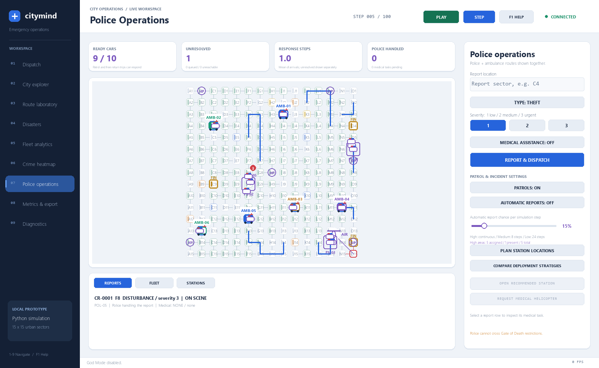
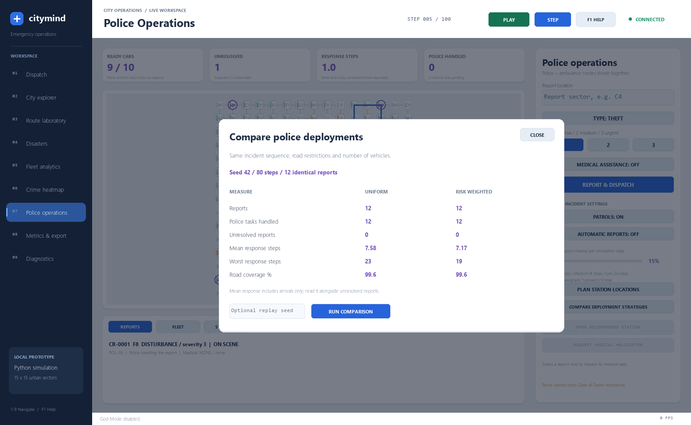

# Police operations: implementation and demonstration

The Python backend now owns police stations, patrol cars, crime reports, response queues, movement, station planning and measurements. Pygame and React display and control the same live state. No crime reports are inserted when a city starts.

## Start and use it

From the project directory containing `core/` and `backend/`, start:

```powershell
python -m uvicorn backend.api.main:app --host 127.0.0.1 --port 8000
```

Then launch the Python interface:

```powershell
python frontend-2d-pygame/main.py
```

Open **Police operations** in the left navigation. React has a **POLICE OPERATIONS** button and uses the same backend.

1. Enter a grid label, such as `C4`, or click its node on the map.
2. Select Theft, Vandalism, Disturbance or Injury; choose severity 1 (low), 2 (medium) or 3 (urgent). Other incident types can also request medical assistance.
3. Press **REPORT & DISPATCH**. Playback starts. Watch the assigned car follow permitted road links, handle the report, and return to its station. Pygame pauses once active responses and returns finish; press **PLAY** to keep routine patrols running. React playback uses its existing play/pause controls.
4. Use the **REPORTS**, **FLEET** and **STATIONS** tabs to inspect incident status, car assignments, reserve cars and station proposals. React lists these in its panel.

Submitting another report at the same node is permitted after its previous report resolves. One unresolved report per node prevents accidental duplicate dispatch.

## What now happens

### Stations and moving patrols

The initial city has three banks, three operational police stations and ten patrol cars, allocated 4/3/3. Banks are BANK zones. Their final locations are chosen after medical-center planning: three different city quadrants, at least four Manhattan blocks from every medical center and seven blocks from one another. A separate seeded random generator selects feasible sites. Existing medical centers, roads and residential plots are preserved.

Each bank is assigned a distinct cardinal direction (east, west, north or south), selected from the feasible randomized layout. The police genetic algorithm places its supporting station exactly two or three grid blocks along that direction, with an open normal-access road route. Stations remain at least two grid blocks from medical centers. Among feasible layouts it maximises city road reach and lowers response costs, with a preference for two-block sites. This is a grid-distance rule; the road route may include more links because of the street layout. New-city initialization rejects a plan that fails bank protection. Stations are service overlays; they do not erase bank or residential zoning or rewrite the crime model.

Gold BANK badges identify bank nodes throughout Pygame; React displays columned gold-roof bank buildings. The Pygame Police STATIONS tab and the React Police panel list each bank's supporting station and grid distance. Full road closures and Gate restrictions can remove bank police access; the bank then displays NO NEARBY ROAD ACCESS. Existing stations stay put. An isolated bank cannot be replaced with a police station: its roads must be restored to regain access. Banks can receive manual crime reports through their normal grid labels. Adding bank buildings does not itself implement valuables, robber movements or a new opportunity forecast.

Seven cars can patrol; one car per initial station is held out of routine patrols as a response reserve. Reserve cars can respond to incidents. The live crime heatmap controls dedicated high-crime circuits and medium/low revisit schedules. Cars travel one permitted road edge per simulation step and are animated between backend positions. A station optimization never teleports existing cars.

Patrols run when **PATROLS** is ON and simulation playback advances. Neighboring HIGH sectors form hotspot areas. Available routine cars receive dedicated moving circuits within those areas. Single-sector hotspots get a short outward-and-back circuit. Larger areas can receive extra cars; station response reserves remain protected. Normal/commercial road permissions apply throughout.

MEDIUM sectors become eligible for another routine visit after **8 simulation steps** without police presence; LOW sectors after **24 steps**. Remaining routine cars choose overdue sectors using time overdue divided by that sector's interval, plus heatmap weight divided by one plus road cost. Thus medium areas receive more frequent visits while low areas still receive occasional checks. Periodic cars return to their station between visits so parking at a visited sector cannot continually reset its timer. Presence at intermediate route sectors, parked posts and incident scenes counts too. Road travel and emergency demand can lengthen actual revisit times; the numbers are simulation intervals, not real-world minutes.

Dijkstra calculates reachable sectors and road costs; A* builds the physical road route. Full blocks and ambulance-only Gate roads are excluded. High-area assignments are reconsidered every step as the heatmap changes. Reports can interrupt routine patrols; another free routine car covers the high area where possible. The UI shows both areas with assigned patrols and areas with cars physically present. A finite fleet cannot guarantee simultaneous presence in every sector: unavailable cars and inaccessible roads produce visible coverage gaps. The uniform comparison strategy retains its separate baseline scheduler.

**PATROLS OFF parks routine patrol cars immediately at their current graph node and cancels their patrol paths.** It does not send every car home. Starting a crime response does not re-enable patrols. Other parked cars remain still unless separately assigned a report. Existing active crime responses and their return trips continue. Automatic incident generation is a separate switch: it may generate legitimate new calls even while routine patrols are OFF. Turn both switches off for a demonstration with only manually submitted incidents.

### Reports, priorities and dispatch

A report is assigned to the free car with the lowest actual permitted road cost from its current location. Routine patrols and free return trips can be interrupted. Cars responding to a report or handling a case are busy. A free car cut off from its home can still handle a reachable local report. When all reachable cars are occupied, the case stays queued. Severity and waiting time determine priority; old low-severity cases gradually gain priority.

After arrival, police spend 2, 3 or 5 steps handling severity 1, 2 or 3 respectively, then drive home unless another report needs them en route. Their completed case does not block new assignments during the return trip. These are configurable simulation durations, not real-world police response or investigation times. The display horizon extends while a case or police return is in progress so it cannot freeze a responder on the way home.

Road changes trigger route recalculation. If a responding car loses access, its report becomes eligible for reassignment. A stranded car remains at its actual position and retries its return after access is restored. Cases with no permitted road access are marked **UNREACHABLE**, with a visible explanation. They are reconsidered when roads or station availability change.

### Gate of Death and full road blocks

Police always use normal-access routes. They cannot cross fully blocked roads or ambulance-only Gate of Death roads. Ambulances retain their existing Gate exception. A police car already inside a gate may handle a report at its current node, but cannot traverse restricted links.

For a demonstration, pause playback, unleash a Gate, then report a crime at an interior node without a police car. Inspect the unreachable report. Clear the Gate, then play the simulation to watch dispatch resume.

### Injury and medical coordination

An Injury report, or a report with medical assistance enabled, also creates or links an actual ambulance emergency. If all ambulances are busy, the medical task waits. Police and medical statuses are tracked separately: completing police work cannot falsely count a patient as rescued or close a case while medical assistance is outstanding.

If the medical network cannot reach the patient by road, select the report row and use **REQUEST MEDICAL HELICOPTER**. React shows this action beside the applicable report. The helicopter flies from its building base to the emergency, delivers directly to the nearest safe hospital, and returns to the closest safe non-hospital building. Takeoff budgets all three legs. Helicopter rescue does not automatically complete an unreachable police task.

If an ambulance has already been dispatched and subsequently loses every road route to the patient, its failed assignment is released before offering helicopter rescue. The original assignment remains in history as aborted; the patient stays unresolved. The ambulance physically returns if it can, and an air rescue can then be requested. An ambulance that can still reach the patient is not cancelled.

### Optional automatic reports

**AUTOMATIC REPORTS** is off initially. Enable it to generate seeded synthetic incidents at residential nodes while simulation time advances. The probability slider is the chance of one new report each step, initially 15%; it is not a measured crime rate. Risk weights influence where reports arise. Switch it off to stop generation.

Crime scores, accumulated reports and unresolved cases remain separate values. A report immediately raises crime scores within a three-cell circular area, strongest at its center and weaker toward the edge. Overlapping reports strengthen the area; unresolved reports keep their footprints elevated. After resolution, the historical contribution fades with a 20-step half-life. Police presence does not erase incident history. The crowded-residential low-baseline rule is a configured simulation assumption, not a demonstrated real-world relationship. See CRIME_HEATMAP_GUIDE.md for the current rules.

### Station planning and construction

**PLAN STATION LOCATIONS** recalculates the genetic plan using current roads, risk and accumulated report demand. It also recommends a central reachable site for each component cut off from existing stations, prioritizing components with more unserved nodes.

**OPEN RECOMMENDED STATION** builds the first current recommendation with two new cars. Existing units keep their positions and homes. Adding a station changes available resources; it is explicitly shown in fleet counts. A plan becomes stale when its road, risk, report-demand or station inputs change; recalculate before construction. There is a maximum of 12 stations and 40 cars.

### Honest comparison and measurements

**COMPARE DEPLOYMENT STRATEGIES** runs uniform and risk-weighted deployments in isolated copies of the current city. Both get the same road closures, number of stations and cars, seeded incident schedule and step budget. Optional replay seeds reproduce the workload. The comparison does not advance or alter the live city.

Compare completed police tasks, unresolved reports, mean/worst arrival time and road coverage together. Mean response includes only incidents reached; a smaller mean alone does not establish a better outcome. Risk-weighted placement can perform worse on an individual seed. Benchmark incidents exclude injury so medical availability cannot confound the police comparison. Default comparison: 12 reports and 80 steps.

Live state also records queued/unreachable cases, medical tasks, car availability, reroutes, travel cost, oldest waiting case and a bounded measurement history. The existing backend metrics CSV export includes police summary fields. Response measurements are simulation steps; road costs have no physical distance/time conversion.

## Jury explanation

"Previously, the project calculated crime risk and displayed police markers. Now that information drives operational decisions: where stations should go, where cars patrol and which car responds to a reported incident. Cars move along real graph routes, wait when resources are occupied and react to blocked roads. Injury reports coordinate police and medical services without treating one service's completion as the other's. We measure the result and compare deployments on identical simulated incidents instead of assuming the algorithm always improves performance."

## Backend interfaces and limits

`GET /state` exposes the `police` object: stations, units, reports, settings, node statistics, recommendations and metrics. Mutating endpoints return an authoritative updated state:

| Endpoint | Purpose |
| --- | --- |
| `POST /simulation/police/reports` | Report a node, type, severity and optional medical need |
| `POST /simulation/police/settings` | Change patrols, automatic incidents or probability |
| `POST /simulation/police/stations/plan` | Calculate current station recommendations |
| `POST /simulation/police/stations` | Construct a currently recommended station |
| `POST /simulation/police/reports/{report_id}/medical_rescue` | Request required helicopter rescue |
| `POST /simulation/police/compare` | Run a frozen, seeded comparison |

Request validation rejects unknown types, invalid nodes, invalid severities, unexpected fields and probabilities outside 0–1. Reports are bounded to 100 unresolved and 1,000 total per city. Comparisons allow 20–200 steps and 1–30 reports. Existing city resets clear police history. State is still an in-memory local prototype; restarting the backend resets the city.

Implementation: `core/police_service.py`; defaults: `config/simulation_config.py`; lifecycle: `core/simulation_engine.py`; API: `backend/api/main.py`; Pygame: `frontend-2d-pygame/screens/police.py`; React: `frontend/src/components/PolicePanel.jsx` and `PoliceUnits3D.jsx`.

## Verification

The domain and API tests cover nearest-cost dispatch, physical travel, handling/return, severity and queue aging, reserves, heatmap patrol circuits and revisit cadence, seeded incidents, closures and Gate permissions, separate medical completion, direct helicopter hospital delivery, stale station plans, construction without teleportation, input bounds and reproducible comparison without live-state mutations.

A dedicated native Pygame event-loop check covers manual reports, actual movement, joint ambulance rescue, automatic incidents, an unreachable gated report, station construction and a comparison using the updated fleet size. Browser coverage exercises injury reporting, actual completion by both services, station planning and comparison alongside existing optimization, export and Gate tests.

Patrol-off regression checks start with cars already patrolling, disable patrols, submit a report, and verify at every step that every unassigned car stays at its parked position. Domain, HTTP API, native Pygame and browser checks cover this workflow. Additional regressions cover interruptible return trips, local response by a car cut off from home, intermediate-node visits, helicopter rescue after a failed road response, and completing a police return beyond the display horizon.




